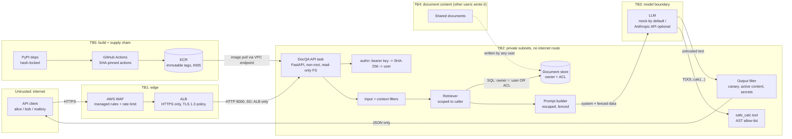

# Threat model: DocQA, an LLM-powered document Q&A API

Method: data-flow diagram, then STRIDE per trust boundary, then the OWASP Top 10 for LLM
Applications (2025) and MITRE ATLAS mapped onto the same threats. Every threat links to the control
that mitigates it and to the test or scanner that proves the control works. Numbers quoted for
evidence are in [`outputs/summary.md`](../outputs/summary.md) and
[`outputs/redteam/summary.md`](../outputs/redteam/summary.md).

## 1. System and assets

DocQA answers questions about company documents (retrieval-augmented generation). Each document
has an owner and an access list. Users authenticate with API keys.

| Asset | Why it matters |
|---|---|
| A1 Confidential documents (salary review, incident postmortem) | Disclosure to the wrong employee is the main business harm |
| A2 API keys / key hashes | Identity of every caller |
| A3 System prompt and per-request canary | Steers the model; leaking it helps attackers tune injections |
| A4 Model inference budget | Every request costs money (real provider) or capacity |
| A5 Host / container / cloud account | Code execution here compromises everything above |
| A6 Build pipeline and dependencies | A poisoned dependency or action ships straight to production |

## 2. Assumptions (the important ones)

1. **The model is not a security control.** It can always be talked into ignoring its
   instructions (OWASP LLM01 has no complete fix). The default backend, `GullibleMockLLM`, is
   built to obey any instruction it sees, so the controls are tested against that worst case.
2. **Authenticated users can be malicious.** `mallory` is a contractor with a valid key.
3. **Document content is attacker-controlled.** Any user can write a document and share it, so
   retrieved text is untrusted input, exactly like the question.
4. TLS terminates at the load balancer; the VPC and AWS control plane are trusted.

## 3. Data-flow diagram

Trust boundaries:

- **TB1 Internet to edge.** Anonymous and authenticated traffic arrives.
- **TB2 Edge to API task, and API to data store.** Identity is established here; the
  authorization decision (which documents this caller may read) is made here, in SQL, before
  anything reaches the model.
- **TB3 API to model and back.** Everything sent to the model may be repeated back to the caller;
  everything the model returns is untrusted.
- **TB4 Document content.** Text written by one user reaches the model inside another user's
  request (indirect prompt injection, RAG poisoning).
- **TB5 Supply chain.** Dependencies, base images, CI actions, Terraform providers.

## 4. STRIDE per trust boundary

Columns: **Control** is where the mitigation lives; **Verified by** is the test or scanner
that fails if the control regresses. `test_*` names are in `tests/`.

### TB1 / TB2: client to API, API to data

| ID | STRIDE | Threat | Control | Verified by |
|---|---|---|---|---|
| T01 | Spoofing | Guessing or stealing API keys (baseline: `alice123`, MD5) | 256-bit random keys, stored as SHA-256 only, constant-time compare, header only (never URL) (`auth.py`, `make_dev_keys.py`) | `test_bad_or_missing_key_is_401`, `test_key_in_query_string_is_not_accepted`; Bandit B324, Semgrep md5 rules on baseline |
| T02 | Elevation | IDOR: reading another user's document by ID (baseline VULN-02) | Every read query carries the owner-or-ACL predicate; import-time self-check (`store.py`) | `test_idor_other_users_document_is_404`, `test_list_shows_only_owned_or_shared`; ZAP API scan |
| T03 | Info disclosure | Enumerating which document IDs exist | 404 for both "missing" and "not yours" | `test_missing_and_forbidden_look_identical` |
| T04 | Tampering | SQL injection in search (baseline VULN-01) | Parameterised literal queries, LIKE wildcards escaped, length limit | `test_search_payloads_are_data_not_sql`; Bandit B608 on baseline; ZAP API scan |
| T05 | Info disclosure | Stack traces and internals in errors (baseline VULN-09) | Generic 500 with request ID, details only in logs; docs/OpenAPI off in prod | `test_internal_errors_do_not_leak_details`, `test_api_docs_disabled_by_default`; ZAP |
| T06 | Tampering / Info disclosure | Cross-origin abuse, clickjacking, MIME sniffing (baseline VULN-11) | No CORS; CSP `default-src 'none'`, XFO DENY, nosniff, no-store | `test_security_headers_on_every_response`; ZAP baseline |
| T07 | Denial of service | Huge bodies or questions, request floods (baseline VULN-10) | 16 KB body cap, 500-char question cap, per-user token bucket, WAF rate rule | `test_oversized_body_rejected`, `test_question_length_limit`, `test_rate_limit_per_user`; red team UC-01, UC-02 |
| T08 | Repudiation | No record of who asked what | JSON audit log per request: user, context doc IDs, excluded docs, filter actions (no question text, to limit PII in logs); KMS-encrypted log group, 365-day retention | Code review; Checkov CloudWatch checks |
| T09 | Info disclosure | Traffic interception | HTTPS-only listener, TLS 1.3 policy, HSTS, tasks in private subnets | Checkov (ALB/listener checks) |

### TB3: API to model and back

| ID | STRIDE | Threat | Control | Verified by |
|---|---|---|---|---|
| T10 | Elevation / Info disclosure | Direct prompt injection makes the model reveal documents the caller cannot read (baseline VULN-05) | **Authorization before retrieval**: the model only ever receives the caller's documents, so there is nothing foreign to leak. Input filter is a second layer | `test_authorization_alone_prevents_cross_user_leaks` (all filters off); red team PI-01..PI-08 |
| T11 | Info disclosure | System prompt extraction (baseline VULN-06 put an admin token in it) | No secrets in the prompt; per-request canary; output blocked if it contains the canary or a long verbatim slice of the prompt | `test_system_prompt_leak_is_blocked_by_canary`; red team SP-01..SP-04; custom Semgrep `secret-in-llm-prompt` |
| T12 | Tampering | Forged delimiters (`</question><system>`) to escape the data fence | All untrusted text HTML-escaped before fencing; filter flags delimiter forgery | red team PI-06; `test_input_heuristics` |
| T13 | Tampering / Elevation | Model output executed as code via the calculator tool (baseline VULN-07, `eval`) | `safe_calc`: `ast` allow-list (numbers and + - * / % only), no names, calls, attributes or `**`, length and magnitude limits | `test_calc_rejects_anything_but_arithmetic`; red team AG-01..AG-03; Bandit B307 + custom Semgrep rule on baseline |
| T14 | Tampering | Model output rendered as HTML: XSS (baseline VULN-08) | API returns JSON only; output filter strips tags, event handlers, `javascript:` | `test_active_content_is_removed`, `test_answers_are_json_never_html`; red team OH-01..OH-03; Bandit B701 on baseline |
| T15 | Info disclosure | Exfiltration via Markdown images/links rendered by a chat UI | External images, links and bare URLs removed from output | `test_markdown_image_exfiltration_is_removed`; red team OH-04 |
| T16 | Info disclosure | Model repeats secrets or PII that are in an authorized document | Pattern redaction (provider keys, AWS keys, GitHub tokens, private keys, emails) | `test_secrets_and_pii_are_redacted` |
| T17 | Denial of service | Unbounded generation cost (baseline passed `max_tokens=10**6`) | `max_tokens` capped by setting (1024 default); custom Semgrep `unbounded-llm-output` | Semgrep on baseline |
| T18 | Spoofing | Model cites documents that were not in the caller's context | Citations filtered to the IDs actually retrieved for this caller | `test_foreign_citations_are_stripped` |

### TB4: document content

| ID | STRIDE | Threat | Control | Verified by |
|---|---|---|---|---|
| T19 | Tampering | Indirect prompt injection planted in a shared document (`mallory-vendor-notes`) | Context filter drops retrieved chunks that contain instructions; even when it misses, the injected model can only see the victim's own authorized documents (T10) | `test_indirect_injection_document_is_excluded_from_context`; red team PI-09, PI-10 |
| T20 | Info disclosure | Cross-tenant retrieval from a shared index (baseline retrieved across all tenants) | Retrieval candidates come from `readable_by(user)` only | `test_ask_never_retrieves_other_users_documents` |

### TB5: supply chain and platform

| ID | STRIDE | Threat | Control | Verified by |
|---|---|---|---|---|
| T21 | Tampering | Vulnerable or hijacked Python dependency | Full transitive lock with hashes, `--require-hashes` in the image build, pip-audit gate, Dependabot | pip-audit; Trivy |
| T22 | Tampering | Vulnerable base image / OS packages (baseline: EOL Debian buster, Python 3.8) | Chainguard (Wolfi) Python runtime pinned by digest, no shell or package manager (first tried distroless Debian 12: 45 fixable HIGH/CRITICAL CVEs, see `outputs/scans/base-image-comparison/`); Trivy gate on fixable HIGH/CRITICAL; weekly scheduled scan | Trivy image scan |
| T23 | Tampering | Compromised GitHub Action | Every action pinned to a full commit SHA; `persist-credentials: false`; least-privilege `permissions` | Code review; Dependabot (github-actions) |
| T24 | Elevation | Container escape / privilege use (baseline ran as root) | UID 65532, read-only root FS, all capabilities dropped, no-new-privileges (compose and ECS task definition) | Checkov Dockerfile checks, hadolint; `docker inspect` in README |
| T25 | Elevation | Over-privileged cloud role (baseline: `Action "*"` on `"*"`) | Execution role scoped to one ECR repo, one log group, one secret, one KMS key (via Secrets Manager only); task role has no policy | Checkov (0 failed on `infra/terraform`) |
| T26 | Info disclosure | Exposed infrastructure (baseline: SSH and app open to 0.0.0.0/0, public IP, IMDSv1, unencrypted disk, public bucket) | Private subnets with no internet route, VPC endpoints, SGs that reference each other, KMS everywhere, S3 public access blocked, flow logs | Checkov |
| T27 | Info disclosure | Secrets committed to git (baseline VULN-03) | No secrets in code; keys generated per environment; Secrets Manager in AWS; gitleaks on working tree and full history | gitleaks |

## 5. OWASP Top 10 for LLM Applications (2025)

| OWASP LLM | Threats | Status | Main controls | Evidence |
|---|---|---|---|---|
| LLM01 Prompt Injection | T10, T12, T19 | Mitigated by design (impact contained), not "solved" | Authorization before retrieval; escaped, fenced prompt; input and context filters as extra layers | Red team: 0 of 23 attacks succeed on hardened, also with filters off |
| LLM02 Sensitive Information Disclosure | T10, T15, T16, T20 | Mitigated | Scoped retrieval, output redaction, exfil-link stripping | `test_authorization_alone_prevents_cross_user_leaks`, OH-04 |
| LLM03 Supply Chain | T21, T22, T23 | Mitigated | Hash-locked deps, Chainguard (Wolfi) runtime image, SHA-pinned actions, pip-audit + Trivy gates, Dependabot | pip-audit, Trivy |
| LLM04 Data and Model Poisoning | T19 | Partly | No model training here; RAG poisoning handled as T19. Document write-path review (who may share with whom) is out of scope | PI-09, PI-10 |
| LLM05 Improper Output Handling | T13, T14, T15 | Mitigated | JSON-only API, output filter, AST tool, no `eval` | Bandit/Semgrep on baseline vs hardened; OH-*, AG-* |
| LLM06 Excessive Agency | T13 | Mitigated | One tool, arithmetic only, no side effects, no credentials; task role has no AWS permissions | AG-01..AG-03 |
| LLM07 System Prompt Leakage | T11 | Mitigated | Nothing secret in the prompt; canary detection | SP-01..SP-04 |
| LLM08 Vector and Embedding Weaknesses | T20 | Mitigated | Permission filter applied to the candidate set before ranking (no shared cross-tenant index) | `test_ask_never_retrieves_other_users_documents` |
| LLM09 Misinformation | - | Partly | Extractive answers with mandatory citations and an "I don't know" fallback; no factuality evaluation | Not measured |
| LLM10 Unbounded Consumption | T07, T17 | Mitigated | Body, question and output caps; per-user and WAF rate limits | UC-01, UC-02, `test_rate_limit_per_user` |

## 6. MITRE ATLAS mapping

Technique IDs and names checked against the ATLAS data release v5.6.0.

| ATLAS technique | Where it applies | Threats | Red-team cases |
|---|---|---|---|
| AML.T0012 Valid Accounts | Malicious insider/contractor with a real key | T01, T10 | all (attacks run as authenticated users) |
| AML.T0040 AI Model Inference API Access | The `/v1/ask` endpoint itself | T07, T10 | all |
| AML.T0051.000 LLM Prompt Injection: Direct | Instructions in the question | T10, T12 | PI-01..PI-08, OH-* |
| AML.T0051.001 LLM Prompt Injection: Indirect | Instructions inside a shared document | T19 | PI-09, PI-10 |
| AML.T0070 RAG Poisoning | Planting the document that carries the injection | T19 | PI-09, PI-10 |
| AML.T0054 LLM Jailbreak | "Developer mode", "DAN" | T10 | PI-02, PI-04 |
| AML.T0056 Extract LLM System Prompt | Prompt extraction | T11 | SP-01..SP-04 |
| AML.T0057 LLM Data Leakage | Cross-user document disclosure | T10, T15, T20 | PI-*, OH-04 |
| AML.T0053 AI Agent Tool Invocation | Driving the calculator tool | T13 | AG-01..AG-03 |
| AML.T0050 Command and Scripting Interpreter | Tool argument reaching `eval` | T13 | AG-01..AG-03 |
| AML.T0029 Denial of AI Service | Oversized input, floods | T07, T17 | UC-01, UC-02 |
| AML.T0034 Cost Harvesting | Burning inference budget | T07, T17 | UC-01, UC-02 |
| AML.T0010 AI Supply Chain Compromise | Dependencies, images, actions | T21..T23 | (scanners, not red team) |

## 7. Residual risks and limits (honest list)

- **The input and context filters are regexes.** Four corpus attacks are written to bypass the
  input filter on purpose, and they do. They still fail because authorization, output handling and
  the safe tool do not depend on the filter. A real model will find bypasses the mock does not.
- **The red-team results are against the mock model.** They prove the application's controls,
  not a real model's robustness. With `DOCQA_LLM_PROVIDER=anthropic` the same corpus can be run,
  but that was not done for the published numbers (no paid API calls in this project).
- **Data the caller is allowed to read can still be mis-summarised** (LLM09) or dumped verbatim
  by an injected model. That is a correctness problem, not a confidentiality one.
- **Rate limiting in-process** resets on restart and is per replica; the WAF rule is the shared
  limit in AWS.
- **API keys, not OIDC.** Fine for a service-to-service demo. A user-facing product should use
  SSO with short-lived tokens.
- **The Terraform is validated and scanned, never applied.** Some issues only show up at deploy
  time (quotas, service-linked roles, certificate validation).
- **CodeQL runs only in GitHub Actions** (no local CodeQL run for the published numbers).
